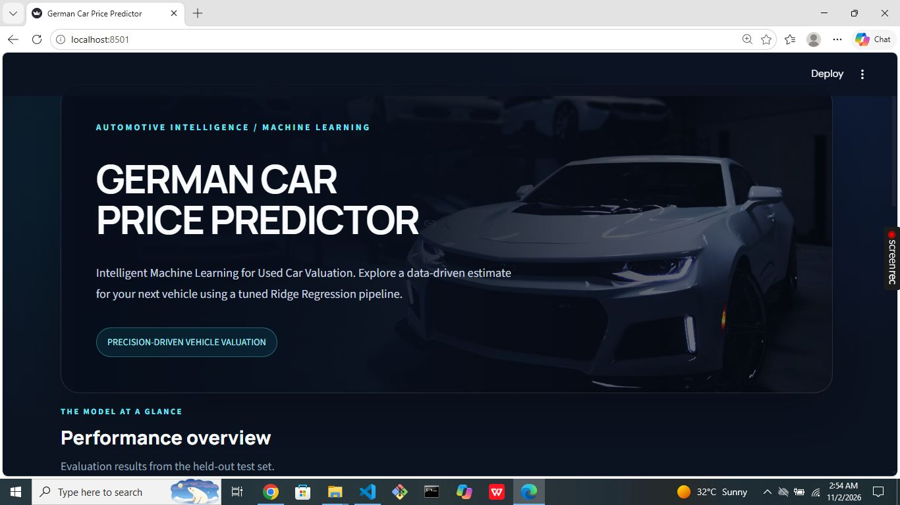
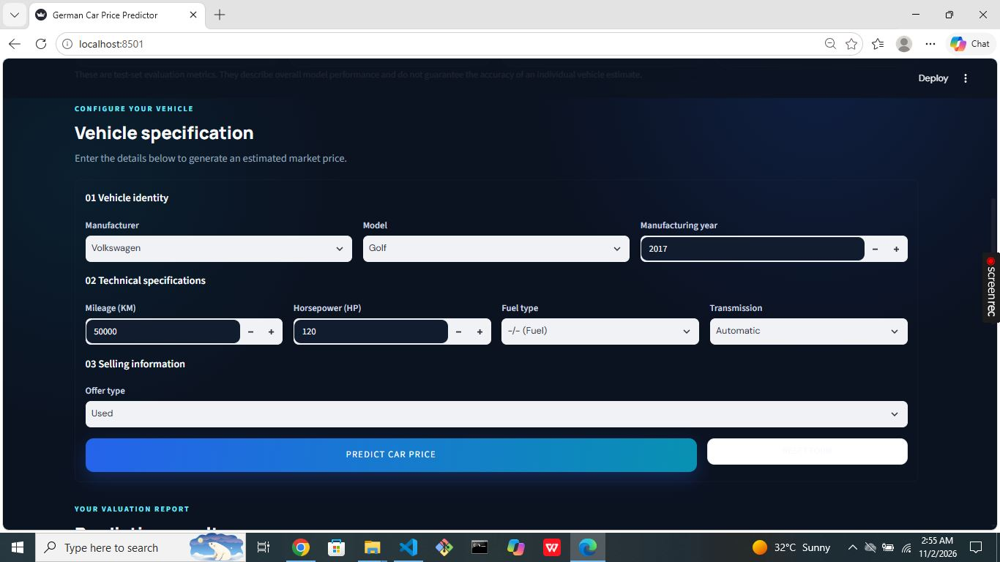
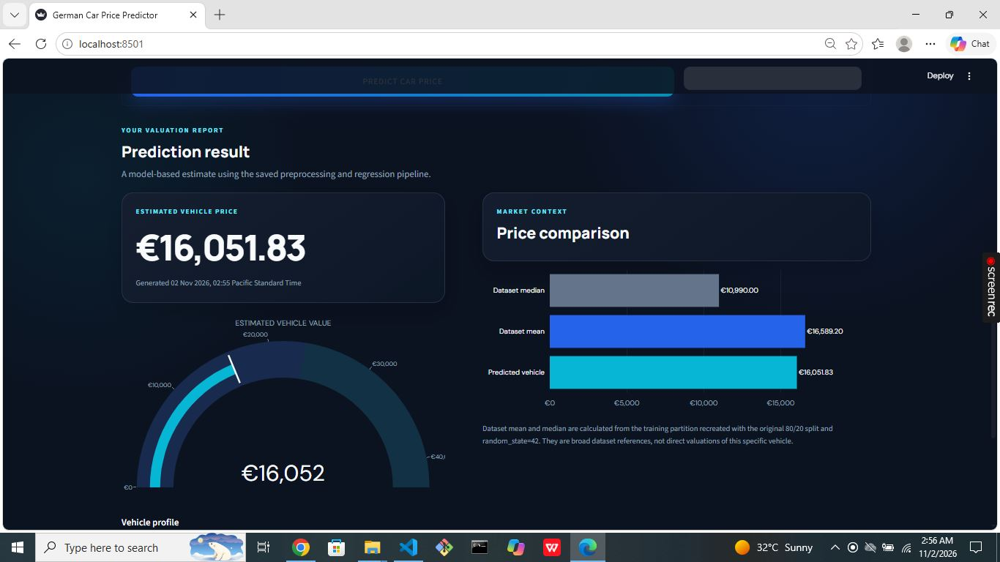

# German Used Car Price Predictor

An end-to-end Machine Learning application that estimates German used car prices using **Tuned Ridge Regression**, Python, and Streamlit.

The project combines data preprocessing, model evaluation, a saved Scikit-learn pipeline, and an interactive automotive-themed web application.

<p align="center">
  
</p>

<p align="center">
  
  
  
  
  
</p>

---

## Project Overview

Used car prices depend on several factors, including manufacturer, model, manufacturing year, mileage, horsepower, fuel type, and transmission.

This project uses Machine Learning to estimate the selling price of a used car based on these vehicle specifications.

The application provides an interactive interface where users can enter vehicle information and receive an estimated price in euros.

**Key capabilities:**
- Predict used car prices using a trained Ridge Regression model.
- Interactive vehicle information form.
- Dependent manufacturer and model dropdowns.
- Animated Plotly price gauge.
- Comparison with actual training dataset mean and median prices.
- Vehicle specification summary.
- Saved preprocessing and prediction pipeline.

## Application Screenshots

### 1. Main Dashboard

<p align="center">
  
</p>

### 2. Vehicle Input Form

<p align="center">
  
</p>

### 3. Prediction Results

<p align="center">
  
</p>

---

## Machine Learning Model

**Selected Model:** Tuned Ridge Regression

The model was selected through hyperparameter tuning using GridSearchCV.

| Evaluation Metric | Result |
|---|---:|
| R² Score | 0.8804 (88.04%) |
| RMSE | €6,530.73 |
| MAE | €2,846.87 |
| Cleaned Dataset Records | 44,260 |
| Training Records | 35,408 |
| Testing Records | 8,852 |

**Model configuration:**
- Algorithm: Ridge Regression
- Hyperparameter: Alpha
- Best alpha: 0.01
- Cross-validation: 3-fold
- Scoring: Negative Root Mean Squared Error

The evaluation metrics describe performance on the test dataset. They do not guarantee the accuracy of an individual prediction.

### Saved Model Pipeline

The application uses the original trained model:

`car_price_pipeline.joblib`

The complete Scikit-learn preprocessing pipeline is preserved, including imputation, scaling, and categorical encoding.

**The application does not retrain the model.**

---

## Dataset and Data Preparation

**Dataset:** [German Used Cars Dataset – Kaggle](https://www.kaggle.com/datasets/ander289386/cars-germany)

The supplied ZIP contained `autoscout24-germany-dataset.csv`, the original 46,405-row dataset.

The cleaned dataset was reconstructed using the cleaning operations documented in `Predictions_model.ipynb`.

### Dataset Cleaning

1. Removed exact duplicate rows.
2. Marked mileage values greater than or equal to 900,000 as missing.
3. Marked horsepower values equal to 1 as missing.
4. Excluded non-passenger vehicle makes:
   - Trailer-Anhänger
   - Trucks-Lkw
   - DAF

| Dataset Stage | Records |
|---|---:|
| Original Dataset | 46,405 |
| Cleaned Dataset | 44,260 |
| Training Set (80%) | 35,408 |
| Testing Set (20%) | 8,852 |

Missing values are intentionally retained for the saved pipeline's preprocessing steps.

### Model Features

**Input features:**
- Mileage
- Manufacturer
- Model
- Fuel Type
- Gear / Transmission
- Offer Type
- Horsepower
- Manufacturing Year

**Target variable:** `price`

---

## Technology Stack

| Technology | Purpose |
|---|---|
| Python | Core programming |
| Pandas | Data manipulation |
| NumPy | Numerical operations |
| Scikit-learn | Machine Learning and preprocessing |
| Ridge Regression | Price prediction |
| Joblib | Model serialization |
| Streamlit | Interactive web application |
| Plotly | Interactive visualizations |
| Custom CSS | Application styling |

---

## Project Structure

```text
Car_Price_Prediction_Premium_App/
│
├── app.py
├── car_price_pipeline.joblib
├── cleaned_cars.csv
├── requirements.txt
├── README.md
├── .gitignore
│
└── screenshots/
    ├── dashboard.png
    ├── vehicle-form.png
    └── prediction-results.png
```

---

## Installation and Setup

### Prerequisites

- Python 3.10
- Git
- Visual Studio Code

### 1. Clone the Repository

```bash
git clone https://github.com/rabbani4294/german-used-car-price-predictor.git
```

### 2. Navigate to the Project Directory

```bash
cd german-used-car-price-predictor
```

### 3. Create a Virtual Environment

Windows PowerShell:

```powershell
py -3.10 -m venv .venv
```

### 4. Activate the Environment

```powershell
.venv\Scripts\Activate.ps1
```

If PowerShell blocks activation:

```powershell
Set-ExecutionPolicy -Scope Process -ExecutionPolicy Bypass
.venv\Scripts\Activate.ps1
```

### 5. Install Dependencies

```powershell
python -m pip install --upgrade pip
python -m pip install -r requirements.txt
```

### 6. Run the Application

```powershell
streamlit run app.py
```

The application will open in your default web browser.

---

## Compatibility

The saved model pipeline was created using:

| Package | Version |
|---|---|
| Scikit-learn | 1.6.1 |
| Joblib | 1.6.0 |

Keep these versions pinned to maintain compatibility with the serialized model.

Verify installed versions:

```powershell
python -c "import sklearn, joblib; print(sklearn.__version__, joblib.__version__)"
```

Expected output:

```text
1.6.1 1.6.0
```

---

## Important Implementation Notes

- Manufacturer and model options are derived from the recreated training partition using the same 80/20 split and `random_state=42`.
- Missing model categories are represented as `Unknown`, matching the saved model's model-column imputer.
- Dataset mean and median are calculated from the recreated training target partition.
- The gauge's upper bound is based on the training target's 95th percentile and expands when a prediction exceeds it.
- The original saved model and preprocessing pipeline are preserved.
- The hero background uses an externally hosted Unsplash image. An internet connection is required to display that image; the rest of the application works locally.

---

## Disclaimer

The predicted price is an estimated value generated by a Machine Learning model. It is not an official market valuation or a guaranteed selling price.

Actual vehicle prices may vary depending on condition, location, maintenance history, market demand, and other factors not represented in the dataset.

---

## Author

**Mubashar Ahmed Rabbani**

BS Computer Science Student | Aspiring Data Scientist

GitHub: [@rabbani4294](https://github.com/rabbani4294)

LinkedIn: [Mubashar Ahmed Rabbani](https://www.linkedin.com/in/mubashar-ahmed-rabbani/)

---

<p align="center">
  <b>German Used Car Price Predictor</b><br>
  Machine Learning • Data Science • Python • Streamlit
</p>
